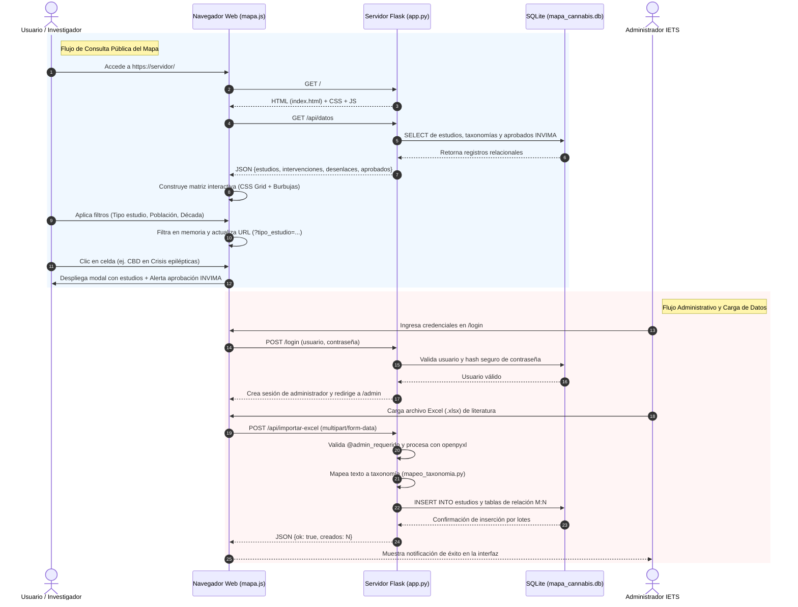

# 🎫 Mapa de Evidencia en Cannabis Medicinal — IETS

<div align="center">
  
  <p><em>Plataforma analítica e interactiva para la síntesis de evidencia biomédica y clínica en cannabis medicinal</em></p>
</div>

---

> **Autora principal:** Silvana Zapata  
> **Soporte tecnológico y arquitectura:** Coordinación de TIC — Instituto de Evaluación Tecnológica en Salud (IETS)  
> **Entidad rectora:** Instituto de Evaluación Tecnológica en Salud (IETS), República de Colombia  
> **Versión:** 1.0.0  
> **Estado:** Operativo / Producción  

---

## 1. Nombre y descripción del proyecto

El **Mapa de Evidencia en Cannabis Medicinal del IETS** es una plataforma web analítica y de acceso abierto diseñada para organizar, sintetizar y visualizar el conocimiento científico disponible sobre la eficacia y seguridad del uso terapéutico del cannabis y sus derivados cannabinoides.

Basado en la metodología internacional de **Mapas de Evidencia y Brechas** (*Evidence and Gap Maps — EGM*), el sistema cruza de manera matricial dos dimensiones estructuradas:
- **Eje Vertical (Filas - 13 Intervenciones):** Organizadas en 4 categorías taxonómicas:
  - *C1. Cannabinoides con registro sanitario* (CBD purificado, Nabiximoles, Dronabinol, Nabilona).
  - *C2. Extractos y preparaciones magistrales* (predominio THC, predominio CBD, balanceados, espectro completo).
  - *C3. Cannabis en flor y otras vías* (vaporizado, fumado, formulaciones tópicas y transdérmicas).
  - *C4. Acceso, prescripción y gobernanza* (programas de acceso, registro de pacientes, guías para prescriptores).
- **Eje Horizontal (Columnas - 15 Desenlaces):** Distribuidos en 4 dominios clínicos y sistémicos:
  - *D1. Eficacia clínica* (dolor crónico, espasticidad, náusea y vómito, crisis epilépticas, apetito/peso, sueño, ansiedad/depresión/TEPT, movimientos anormales).
  - *D2. Calidad de vida y función* (calidad de vida, funcionalidad).
  - *D3. Seguridad* (eventos adversos, efectos psiquiátricos/cognitivos, dependencia y accidentes).
  - *D4. Sistema de salud* (ahorro/sustitución de otros medicamentos, costos y uso de servicios).

El mapa clasifica las publicaciones entre **síntesis de evidencia** (revisiones sistemáticas, revisiones paraguas, metaanálisis, GPC, ETS) y **estudios primarios** (ensayos clínicos aleatorizados, estudios observacionales, evaluaciones económicas), resalta visualmente las **brechas de investigación** (*research gaps*) y vincula las aprobaciones sanitarias oficiales vigentes ante el **INVIMA** en Colombia.

---

## 2. Tecnologías utilizadas

| Tecnología | Versión | Uso en el proyecto |
|:---|:---|:---|
| **Python** | 3.10+ (PaaS: 3.12.4) | Lenguaje base del backend y scripts de procesamiento. |
| **Flask** | 3.1.3 | Microframework web para rutas HTTP, API REST y renderizado de vistas Jinja2. |
| **Gunicorn** | 23.0.0 | Servidor WSGI HTTP concurrente para despliegue en entornos Linux/PaaS. |
| **openpyxl** | 3.1.5 | Lectura, parsing y extracción automatizada de matrices en formato Excel (`.xlsx`). |
| **SQLite3** | Integrado en Python | Motor relacional embebido con integridad referencial activa (`PRAGMA foreign_keys = ON`). |
| **HTML5 / Jinja2** | Semántico W3C | Maquetación accesible de la interfaz y plantillas dinámicas del servidor. |
| **Vanilla CSS3** | Custom Properties | Sistema de diseño institucional IETS, CSS Grid bidimensional nativo y layout responsivo sin preprocesadores. |
| **Vanilla JavaScript (ES6+)** | Estándar W3C | Lógica cliente reactiva (`fetch`, filtros multidimensionales, manipulación de DOM y sincronización de URL). |
| **Google Fonts (Inter)** | Web Font | Tipografía institucional corporativa optimizada con `preconnect`. |

---

## 3. Requisitos previos

- **Python:** Versión 3.10 o superior (recomendado 3.12.x).
- **Gestor de paquetes:** `pip` actualizado.
- **Git:** Para clonar el repositorio.
- **Sistema Operativo:** Compatible con Windows, Linux y macOS.

---

## 4. Instalación

### Paso 1: Clonar el repositorio
```bash
git clone https://github.com/FerneyEnriqueBarbosa/mapa-evidencia-cannabis.git
cd mapa-evidencia-cannabis
```

### Paso 2: Crear y activar un entorno virtual

- **En Windows (PowerShell):**
  ```powershell
  python -m venv venv
  .\venv\Scripts\Activate.ps1
  ```
  *(Si el sistema bloquea scripts: `Set-ExecutionPolicy -ExecutionPolicy RemoteSigned -Scope CurrentUser`)*

- **En Linux / macOS (Bash / Zsh):**
  ```bash
  python3 -m venv venv
  source venv/bin/activate
  ```

### Paso 3: Instalar dependencias
```bash
pip install --upgrade pip
pip install -r requirements.txt
```

### Paso 4: Inicializar la base de datos relacional
```bash
python database.py
```
> **Nota:** La función `init_db()` es idempotente. Si el archivo de base de datos no existe, se crea el esquema relacional DDL, se configuran los usuarios administradores/editores por defecto, se cargan los 9 medicamentos INVIMA y se siembran los estudios científicos a partir de `insumos/Extracción final (1).xlsx` (o el fallback `data/estudios_seed.json`).

---

## 5. Configuración (Variables de entorno)

El comportamiento de la plataforma puede ser ajustado mediante variables de entorno en el sistema operativo o en la configuración del proveedor de nube:

| Variable | Tipo | Valor por defecto | Descripción |
|:---|:---|:---|:---|
| `PORT` | Entero | `5000` | Puerto TCP en el que el servidor escucha conexiones HTTP. |
| `DEBUG` | Booleano | `False` | Activa el modo de depuración y recarga automática de Flask (solo desarrollo). |
| `MAPA_DB_PATH` | Ruta | `./mapa_cannabis.db` | Ubicación del archivo de base de datos SQLite (en producción se usa `/var/data/mapa_cannabis.db`). |
| `SECRET_KEY` | Cadena | *(Clave por defecto de desarrollo)* | Clave criptográfica para la firma de cookies de sesión Flask. |
| `ADMIN_USER` | Cadena | `admin` | Nombre de usuario con perfil Administrador institucional. |
| `ADMIN_PASSWORD`| Cadena | `AdminIETS2025!` | Contraseña inicial para el perfil Administrador (almacenada con hash `werkzeug.security`). |
| `EDITOR_USER` | Cadena | `editor` | Nombre de usuario para el perfil de Editor científico. |
| `EDITOR_PASSWORD`| Cadena | `EditorIETS2025!`| Contraseña inicial para el perfil de Editor científico. |
| `PYTHON_VERSION`| Cadena | `3.12.4` | Versión de entorno de ejecución para plataformas PaaS (Render). |

---

## 6. Cómo ejecutar el proyecto y las pruebas

### Ejecución en entorno de desarrollo local
```bash
python app.py
```
El aplicativo estará accesible de forma inmediata en [http://localhost:5000](http://localhost:5000).

### Ejecución en entorno de producción (Gunicorn)
Para servidores de producción Linux o contenedores:
```bash
gunicorn app:app --bind 0.0.0.0:5000 --workers 3 --threads 2 --timeout 60
```

### Ejecución de las pruebas automatizadas
El proyecto cuenta con una suite completa basada en `unittest` que valida seguridad, endpoints, consistencia de datos e importación:

```bash
# Ejecutar todas las pruebas descubiertas
python -m unittest discover -v -s . -p "test_*.py"

# Ejecutar suites específicas:
python -m unittest test_security.py           # Seguridad, RBAC y dimensiones retiradas de UI
python -m unittest test_robustness.py         # Idempotencia, integridad relacional y casos de borde
python -m unittest test_aprobados_colombia.py # Medicamentos INVIMA y cruces taxonómicos
python -m unittest test_excel_import.py       # Importación y parsing de archivos Excel (.xlsx)
```

---

## 7. Estructura del proyecto

```text
mapa-evidencia-cannabis/
├── app.py                         # Servidor Flask, enrutamiento, controladores de API REST y seguridad
├── database.py                    # Esquema DDL SQLite, transacciones, roles, catálogos y migración
├── requirements.txt               # Dependencias de producción (Flask, gunicorn, openpyxl)
├── Procfile                       # Comando de inicio WSGI para despliegue en la nube
├── render.yaml                    # Manifiesto de infraestructura en Render con volumen persistente
├── GUIA_DISENO.md                 # Pautas corporativas y tokens visuales del sistema de diseño IETS
├── Plantilla README.md            # Plantilla base institucional
├── README.md                      # Documentación técnica integral del repositorio
├── test_aprobados_colombia.py     # Pruebas de integración de medicamentos INVIMA
├── test_excel_import.py           # Pruebas de importación de matrices Excel
├── test_robustness.py             # Pruebas de resiliencia, idempotencia y validación de datos
├── test_security.py               # Pruebas de autenticación, autorización y filtros de UI
│
├── data/                          # Módulos de datos y taxonomía
│   ├── taxonomia.py               # Estructura formal de 13 intervenciones (C1-C4) y 15 desenlaces (D1-D4)
│   ├── estudios_semilla.py        # Cargador de publicaciones científicas y normativa colombiana
│   ├── estudios_seed.json         # Respaldo estructurado de estudios en formato JSON
│   ├── mapeo_taxonomia.py         # Motor algorítmico de asignación de texto clínico a códigos I/O
│   └── medicamentos_invima.py     # Catálogo oficial de medicamentos autorizados por INVIMA en Colombia
│
├── insumos/                       # Archivos fuente institucionales
│   ├── Extracción final (1).xlsx  # Matriz de extracción con la literatura científica original
│   └── Medicamentos aprobados INVIMA (1).xlsx # Datos oficiales de registros sanitarios
│
├── templates/                     # Vistas HTML (motor de plantillas Jinja2)
│   ├── index.html                 # Vista pública principal: mapa matricial, modal, filtros y documentación
│   ├── admin.html                 # Panel de administración: gestión de estudios y taxonomías
│   └── login.html                 # Pantalla de autenticación y control de acceso
│
└── static/                        # Recursos web cliente
    ├── css/
    │   └── app.css                # Estilos corporativos IETS, variables CSS, grid de la matriz y modales
    └── js/
        ├── mapa.js                # Lógica del mapa público: renderizado dinámico, filtros, URL y CSV
        └── admin.js               # Lógica del panel administrativo: formularios, tablas dinámicas y CRUD
```

---

## 8. Flujo de la aplicación

### Explicación técnica paso a paso

1. **Carga inicial de la aplicación:**
   - El cliente ingresa a `GET /`. El servidor Flask (`app.py:vista_mapa`) renderiza la plantilla base `templates/index.html` sirviendo los estilos (`static/css/app.css`) y el script principal (`static/js/mapa.js`).
   - Al cargarse el DOM, `mapa.js:cargar()` ejecuta una petición asíncrona a `GET /api/datos`.

2. **Procesamiento de datos en el backend:**
   - El endpoint `/api/datos` (`app.py:datos`) consulta la base de datos relacional SQLite (`database.py:get_conn`), uniendo las tablas `estudios`, `intervenciones`, `desenlaces`, `categorias_intervencion`, `dominios_desenlace`, `normativa` y `medicamentos_aprobados`.
   - Se procesan las relaciones muchos a muchos (`estudio_intervencion` y `estudio_desenlace`) y se normaliza el tipo de eje (`sintesis` vs `primario`) mediante `database.py:eje_de_tipo()`. La respuesta es entregada en formato JSON estandarizado.

3. **Construcción dinámica de la matriz y filtros en el cliente:**
   - `mapa.js` construye un índice multidimensional en memoria (`Map`) indexando los estudios por cada celda de cruce `intervencion_id:desenlace_id`.
   - Genera los desplegables de filtrado reactivo: **Tipo de estudio** (`tipo_estudio`), **Población** (`poblacion`) y **Período cronológico** (`decada`), además de enlazar el campo de búsqueda textual.
   - Lee los parámetros de búsqueda de la URL (`URLSearchParams`) para restaurar filtros persistidos si el usuario ingresó mediante un enlace directo.
   - Dibuja la matriz con CSS Grid: encabezados fijos (*sticky headers*) de categorías y dominios, botones de filas/columnas y celdas interactivas con cálculo de tamaño de burbuja proporcional o intensidad cromática (mapa de calor).

4. **Interacción del usuario y filtrado:**
   - Cuando el usuario activa un filtro o escribe en el buscador, `mapa.js:estudiosFiltrados()` reevalúa el subconjunto de estudios coincidentes, recalcula los totales de fila y redibuja las burbujas instantáneamente sin recargar la página.
   - La selección se sincroniza en tiempo real en la barra de direcciones del navegador (`history.replaceState`), facilitando compartir vistas específicas.

5. **Apertura de ficha técnica / modal:**
   - Al pulsar sobre una celda, intervención o desenlace, se ejecuta `abrirModalCelda()` o similar en `mapa.js`.
   - Si la celda corresponde a una indicación con aprobación sanitaria en Colombia, se consulta el índice de `aprobados_colombia` y se inyecta una tarjeta destacada con los datos del registro sanitario INVIMA.
   - Se despliega el listado de estudios con metadatos (diseño, autores, año, muestra $n$, resumen clínico y enlace externo directo a DOI/PubMed).

6. **Gestión y mutación administrativa (Rutas protegidas):**
   - Para crear, editar, eliminar o importar estudios o taxonomía, el usuario debe autenticarse en `POST /login` (`app.py:vista_login`), donde se valida la contraseña con hash seguro mediante `database.py:verificar_usuario`.
   - Las rutas de mutación (`/api/estudios`, `/api/importar`, `/api/importar-excel`, etc.) están protegidas con el decorador `@admin_requerido`. Si un usuario no autenticado intenta realizar una petición `POST/PUT/DELETE`, el sistema retorna inmediatamente un código HTTP `401 Unauthorized`.
   - Al subir un archivo Excel en `/api/importar-excel`, el servidor usa `openpyxl` para extraer filas, y `data/mapeo_taxonomia.py:mapear_estudio` asigna automáticamente los códigos taxonómicos basándose en coincidencias de texto clínico.

### Diagrama de secuencia de la aplicación



---

## 9. Roles y control de acceso (RBAC)

La plataforma cuenta con control de acceso basado en sesiones seguras para dos niveles:
1. **Público / Ciudadano:** Acceso de sólo lectura a la matriz, los filtros interactivos, las fichas técnicas de estudios, la documentación metodológica y la exportación de microdatos en formato CSV (`/`, `/api/datos`, `/api/catalogos`, `/api/aprobados-colombia`, `/api/salud`).
2. **Administrador / Editor:** Acceso exclusivo tras autenticación en `/login`:
   - **Administrador (`rol: admin`):** Control total del aplicativo, edición y eliminación de estudios, gestión de la estructura taxonómica (crear/modificar intervenciones, desenlaces, categorías y dominios) y carga masiva desde archivos Excel o JSON.
   - **Editor (`rol: editor`):** Gestión de estudios clínicos y curaduría de publicaciones.
